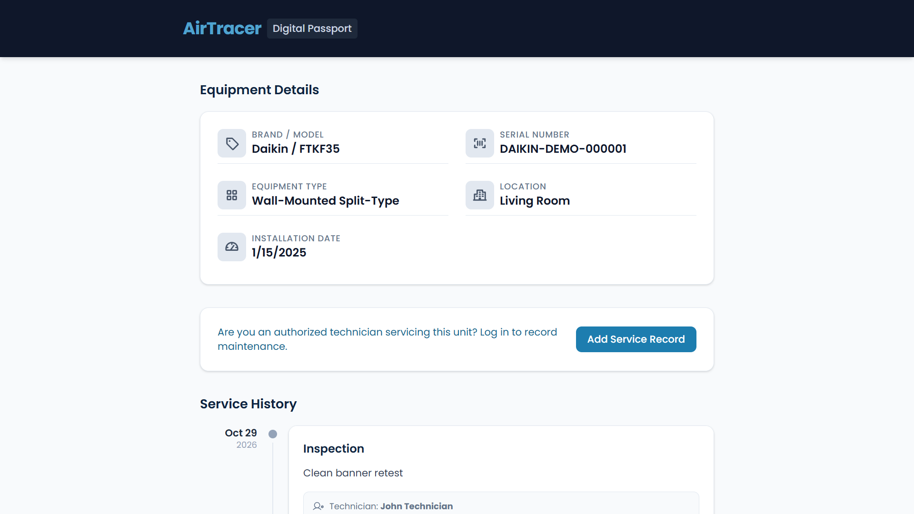
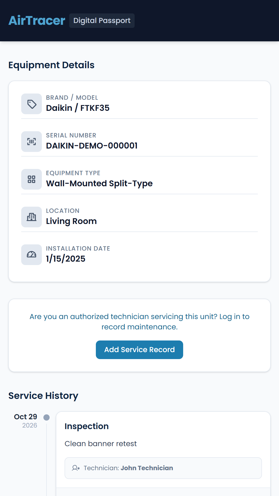

# AirTracer

AirTracer is a QR-enabled digital service passport for air-conditioning (AC) units. Each registered unit gets a QR code that opens its passport: the equipment details and its full maintenance history, including measurements, findings, recommendations and photos. The history stays with the unit, so it is not lost when different technicians or service companies work on it.

AirTracer works with any brand and any service provider. It has two roles:

- **Owners** register their AC units, print QR labels and review service history.
- **Technicians** scan units on-site and record the service they performed.

One account can hold both roles.

## Live demo

**[airtracer-pwa-dev.vercel.app](https://airtracer-pwa-dev.vercel.app)**

This is the development deployment, so its data may change or be reset. The API is hosted on Render. To try it, register an account as an owner or a technician. You can add the other role later from your account.

## Screenshots

<p>
  
  
</p>

## Features

- **Accounts and roles:** register as an owner or a technician, and add the other role at any time.
- **Equipment:** register AC units with type, brand, model, serial number, capacity and location, and deactivate them when they leave service.
- **QR codes:** generate, regenerate or deactivate a unit's QR code, and print a label.
- **Public passport:** anyone who scans the QR code sees the unit's approved public details and service history, without signing in.
- **Scanning:** scan QR codes with the device camera, or enter the code by hand.
- **Service records:** record the service type, outcome, measurements (pressures, current, voltage, air temperatures), findings and recommendations. Records cannot be edited or deleted. A wrong record is voided with a reason and stays visible in the history.
- **Photo evidence:** attach photos to service records.
- **Installable app:** install AirTracer on a phone or desktop like a native app.
- **Offline use:** save passports for offline viewing, and create service records offline. Offline records upload automatically when the connection returns.

Measurements are entered by hand. AirTracer does not read sensors, diagnose faults, take payments or include an admin role. See [PRD §3.2](apps/docs/PRD.md#32-out-of-scope) for the full out-of-scope list.

## Tech stack

| Part | Technologies |
|---|---|
| API | NestJS, TypeScript, Prisma, PostgreSQL, JWT authentication, Argon2 |
| PWA | React, TypeScript, Vite, Tailwind CSS, TanStack Query, Workbox |
| Storage | Supabase Storage for service photos |
| Hosting | Render (API), Vercel (PWA) |

## Repository layout

| Path | Contents |
|---|---|
| [`apps/api`](apps/api) | REST API, database schema and migrations |
| [`apps/pwa`](apps/pwa) | Web app and PWA |
| [`apps/docs`](apps/docs) | Product requirements, API contract and agent instructions |

This is a pnpm workspace. Run the commands below from the repository root.

## Run locally

You need:

- Node.js 24
- pnpm 11
- A PostgreSQL database
- A Supabase project with a private `service-photos` bucket (see the [API README](apps/api/README.md#supabase-storage))

```bash
pnpm install
```

```bash
cp apps/api/.env.example apps/api/.env
```

Fill in the values in `apps/api/.env`. The [API README](apps/api/README.md#environment-variables) explains each one. Then run:

```bash
pnpm --filter api db:generate
```

```bash
pnpm --filter api db:migrate
```

```bash
pnpm dev
```

The PWA opens at http://localhost:5173 and the API runs at http://localhost:3000. To load sample data, see [Seeding](apps/api/README.md#seeding). Seeding deletes existing equipment and records.

## Tests

Tests run separately for each app:

```bash
pnpm --filter api test
```

```bash
pnpm --filter api test:e2e
```

```bash
pnpm --filter pwa test
```

The API end-to-end tests need a local test database. See the [API README](apps/api/README.md#testing).

## Documentation

- [API README](apps/api/README.md): setup, environment variables, database and deployment
- [PWA README](apps/pwa/README.md): configuration, pages, offline support and deployment
- [Product requirements (PRD)](apps/docs/PRD.md): what the product does and why
- [API contract](apps/docs/api-contract.md): verified endpoints, payloads and responses
- [Agent instructions](apps/docs/AGENTS.md): rules for AI coding agents working in this repository
